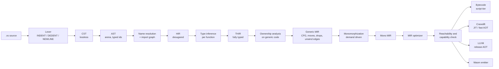

# 02. Compiler architecture

## 2.1 Pipeline



Everything left of `Generic MIR` is **target independent and library
independent**. Everything from `Mono MIR` onward knows the target. Nothing
in the front end ever sees a target triple.

## 2.2 Stage contracts

Each stage has an input invariant it may rely on and an output invariant it
must establish. A violated invariant is a compiler bug and is caught by the
MIR verifier (`verse-verify`). After MIR build and after monomorphization it
runs in every build of `verse`: in `build`, when running a file and in
`verse check`. After every optimizer pass it runs only in debug builds of
`verse` and in CI ([13 §13.5](mir-specification.md#135-verifier-rules)).

| Stage | Input invariant | Output invariant | Errors it owns |
|-------|-----------------|------------------|----------------|
| Lexer | valid UTF-8 | balanced `INDENT`/`DEDENT`, tabs rejected, every byte covered by a token or trivia | bad indentation, unterminated text, invalid escapes |
| Parser | token stream | CST whose text round-trips byte for byte; error nodes where parsing failed, never a panic | syntax errors, with recovery at line and block boundaries |
| AST lowering | CST | each node has a stable `NodeId` and span; trivia discarded | none |
| Name resolution | AST of all modules in a package | every identifier is a `Def` id or a local id; the no-shadowing and refinement rules (§3.9) enforced; a refinement is a new local id; import graph acyclic (§12.2) | unknown name, hidden name, an import cycle (V0310), visibility |
| HIR lowering | resolved AST | no sugar: `otherwise`, `try`, `if…is`, key-path lambdas, postfix guards, string interpolation and `for` are expanded to a small core. Optional-lifting positions (§8.1) are marked but not yet typed | none |
| Type inference | HIR | every expression has a type or a recorded unresolved variable; unresolved variables become the "cannot infer, annotate here" error (§4.2 rule 4) | type errors, missing annotations, optional misuse, non-exhaustive patterns, a cycle among a module's constant initializers (V0426, §12.4, [ADR-0010](../decisions/0010-constant-initialization-cycles.md)) |
| Ownership | THIR | every use is classified as move, copy, borrow or mut borrow; every drop point is known; see 2.4 | use after move, borrow rules, `Copy` bound errors, task rules (`mut` borrows sent to tasks, one owner per `Receiver`) |
| MIR build | THIR plus ownership facts | CFG of basic blocks; locals typed; explicit `Move`, `Copy`, `Drop`, unwind edges | none |
| Monomorphization | generic MIR | no type parameters, no structural constraints, no `Show` or `Eq` left abstract; trait calls resolved except calls through a trait name used as a type; every instance carries `recursive` exactly when it is on a cycle of the call graph ([13 §13.3](mir-specification.md#133-types-and-layout-facts)) | none |
| Optimizer | mono MIR | semantics preserved; verifier passes after every pass in debug builds | none |
| Reachability and capability check | optimized mono MIR (in script mode, the pre-pass of 2.6) | the set of functions, types, vtables, constants and platform capabilities actually used, from the program's entry points; every used capability is granted and provided by the target, or the build or run stops before any code runs | capability errors (V09xx): a reachable capability that is not granted, that the target cannot provide, or that a package does not declare; the `--no-heap` checks (allocation, channel capacity, bounded `spawn`) |
| Backends | reachable mono MIR | an artifact for the selected target | target limits that are not capabilities (for example "no threads on this target", a recursive wait on a state-machine target) |

The codes each stage reports are listed in
[16 §16.2.1](../reference/diagnostics-catalog.md#1621-families-by-pass).

## 2.3 Data structures

Choices made for speed and for cache behavior. All are **assumptions** until
the M0 benchmarks run ([11](../roadmap.md)).

- **Interned strings and types.** Identifiers, text literals and types are
  interned to `u32` ids. Type equality is integer equality.
- **Arenas with typed indices.** AST, HIR, THIR and MIR nodes live in
  per-module arenas (`Vec<Node>` addressed by `NodeId(u32)`). No `Rc`, no
  per-node heap allocation. Freed all at once.
- **Lossless syntax tree for tools only.** The formatter and language server
  use a CST (green tree, structurally shared, cheap to re-parse after an
  edit). The compiler proper uses the AST, so the hot path never touches
  trivia.
- **Struct of arrays for MIR.** Statements and terminators are stored in
  flat arrays per function. Basic blocks hold index ranges. Passes iterate
  linearly.
- **Spans** are `(file_id: u32, start: u32, end: u32)`. Line and column are
  computed on demand from a per-file line table.

## 2.4 The ownership pass

This is the pass with the most unusual contract, so it is specified here.

**Where it runs.** On THIR of the generic definition, once per function.
Never again for specializations (spec §4.2 rule 9). Consequence: ownership
errors are reported at the definition, and a call site can fail only on an
unmet bound (§4.2 rule 9, final paragraph).

**What it computes.**

1. **Liveness and last use** for every local, by backward dataflow over the
   function's CFG. Needed because a copy at the source's last use is compiled
   as a move, which costs no count (§4.9), and because a value is dropped
   right after its last use (§13.1), which places every drop. Last use never
   changes what a program means, only what a copy costs.
2. **Place states**: each place (local, field path, element-in-place) is in
   one of `Owned`, `MovedAt(site)`, `Borrowed(kind)`. Only a value that is not
   `Copy` reaches `MovedAt`; a `Copy` value at its last use is moved, but its
   source is dead, so the state is never read.
   Conditional moves produce **drop flags**, as in Rust MIR drop elaboration.
3. **Second-class borrow rules**. Because borrows cannot be stored, returned
   or sent to a task, a borrow's lifetime is the dynamic extent of one call.
   The check is therefore a local rule, not a lifetime solver:
   - a `mut` argument is exclusive for the call, with arguments evaluated
     first and the borrow starting after (§4.10 example);
   - a borrowed value that flows into a stored position, a return or `spawn`
     is copied there, and one that is not `Copy` cannot flow there.
4. **Chain classification**: adapters such as `filter` and `zip` hand
   elements along without copying them, and the chain end builds the result
   (§9.5). The pass records, for each chain, the step that collects it, and
   whether its source is at its last use, so the elements move instead of
   being counted.
5. **Copies of generic values.** A copy of a value whose type is a type
   parameter needs a written `Copy` bound; without one it is an error at the
   definition. No bound is inferred.
6. **Explanations.** Every ownership error carries a structured explanation:
   the move site, the branch condition of a move made on one path, the rule
   number, and the suggested fix. This is a hard requirement from spec §18.10 ("error
   messages carry the burden") and it is also what the debugger shows
   (see [08](debugging.md)).

**Why a custom pass and not a borrow checker port.** Rust's borrow checker
solves lifetimes across stored references. Verse has none, so a full
region-inference engine would be unused complexity ([ADR-0002](../decisions/0002-ownership-on-generic-code.md) explains why we
do not copy it; compare Hylo and Swift's ownership model, where
second-class values also make the analysis local).

## 2.5 Type inference

Hindley–Milner style unification with trait and callable constraints,
solved **per function** and **per module**.

- **Exported items are written in full** (spec §4.2 rule 1): parameter types,
  return type and `raises` clause. A missing one is V0418, reported before
  inference, so an export's signature is known without its body.
- **Unannotated parameters of private functions** used only through trait
  operations become implicit generics with `Trait(T)` and
  `Callable(T, args, ret)` constraints.
- **A parameter whose body reads a field or calls an inherent method** is a
  type variable shared by every call of the function in its module, and the
  calls fix it to one concrete type. Two calls that pass different types are
  V0425. There are no structural constraints, so generic MIR needs no
  `has` bounds (13 §13.2).
- **Recursion** requires annotations (rule 3), so inference never needs a
  fix-point across a call cycle. Strongly connected components of the call
  graph are checked to ensure every cycle has an annotated entry.
- **Numeric literals** default after solving: any literal type variable still
  unconstrained becomes `Int` or `Float` (rule 2).
- **Module boundary.** An exported function's written signature is compared
  with `verse.api`. Importers use only `verse.api` (§16.4), so a module can be
  checked without the source of its dependencies. This is what lets us
  compile packages independently and in parallel.
- **Raise sets** are inferred from `try` with the return type, exact as in §4.6,
  and checked against a written `raises` clause in both directions (V0420,
  V0421).

## 2.6 Monomorphization

Spec §4.2 requires "specialized code for each concrete type used".

- **Demand driven.** Starting from the entry statements (or from exports when
  building a library) and from tests, instantiate a function when a call
  instantiates it. This gives exact reachability for free.
- **Instance key** is `(DefId, [TypeId])` after canonicalization.
- **Code bloat controls**: identical instances after layout erasure (for
  example `List<Int>` and `List<Float>` for pure moves, both 8 bytes) can be
  merged by the linker (identical code folding). A trait name used as a type
  (spec §10.3) is the user-visible escape hatch for compile-time-sensitive
  code: it is one shared body instead of one copy per type.
- **Script mode** verifies eagerly and generates **bytecode** lazily at first
  call, so bytecode generation and optimization scale with what runs. Before
  tier 0 starts, running a file performs a whole-program **reachability
  pre-pass** from the entry statements. It monomorphizes every reachable
  instance (resolving trait calls and vtable slots) and verifies each one with
  the mono rules of [13 §13.6](mir-specification.md#136-generic-mir-and-mono-mir).
  It builds no bytecode, runs no optimizer pass, and caches each verified
  instance (2.7). A verifier failure (V9902) stops the run there, before the
  first statement. The **capability check** runs right after it, exactly as it
  runs after full reachability in a compiled build, so a missing or denied
  capability fails with the same V09xx diagnostic in every tier before the
  first instruction. `verse check` runs the same pre-pass and the same check,
  with the `[run] deny` list of `verse.toml`. What a passing check promises
  about a run is the rule of
  [16 §16.6.1](../reference/diagnostics-catalog.md#1661-exit-statuses). Only
  the pre-pass scales with what is reachable; protos are still built lazily
  ([14 §14.6](bytecode-and-vm.md#146-calls-and-lazy-bytecode-generation)).

## 2.7 Incremental and parallel compilation

- **Query architecture.** Every pure function of its inputs is a memoized
  query keyed by content hash (the Salsa model used by rust-analyzer). Edits
  invalidate only dependent queries.
- **Unit of parallelism** is the function body for inference, ownership and MIR
  build; the module for parsing and resolution; the instance for
  monomorphization, verification, optimization and code generation.
- **Persistent cache.** `.verse/cache/` stores parsed modules and signatures
  keyed by `blake3(source, compiler version, flags, verse.api of imports)`.
  It stores each verified instance of the script-mode pre-pass
  (2.6) under its own **verified-instance key**, which is transitive. The key hashes
  the compiler version, flags, target, the generic MIR of the instance's
  DefId and its type arguments, together with the keys of the instances it
  calls (drop glue included), the impl each of its `<T as Trait>::m` calls
  resolves to, and the layout of every type it uses. A change below an
  instance therefore changes its key: a callee that gains a capability or a
  `yield`, an impl that changes, or a type whose layout changes. This matters
  because V18 and V19 read the `mayyield` and `caps` of callees
  ([13 §13.5](mir-specification.md#135-verifier-rules)). Instances that call
  each other in a cycle share one key, hashed over the whole cycle. An
  instance of an imported generic takes its body from the dependency, whose
  `verse.api` stays the same when only that body changes, so the module key
  would return a stale instance. `verse x.vs` on an unchanged script skips
  straight to execution.
- **Object code** is stored per instance under its **object key**:
  `blake3(optimized mono MIR of the instance, layouts of the types it uses,
  compiler version, backend, codegen flags, target)`. It hashes the
  optimized body, not the verified-instance key, because the optimizer
  writes whole-program facts into an instance: `inline` takes in a callee
  that has one caller in the program, and `refcount-opt` drops atomic
  counts when the program never spawns
  ([03 §3.4](ir-and-passes.md#34-pass-list)). The optimized body holds every
  callee body it took in and every such decision, so a changed dependency
  body or a new `spawn` elsewhere changes the key.
- **Optimized instances** are cached as well. The optimizer reads a
  whole-program fact only through a query (the callers of a function, whether
  a `spawn` is reachable), so the query system records every fact each
  optimized instance read. A cached optimized instance is reused while its
  verified-instance key and the value of every fact it read are unchanged. A
  pass that reads one more fact reads it through a query too, so no list of
  facts is kept by hand. Rerunning the optimizer on every build would not be
  cheap: in rustc, as measured with `tools/measure/opt-vs-codegen/`, the
  optimizing MIR passes cost 8% to 10% of LLVM code generation but 25% (debug)
  to 75% (release) of Cranelift code generation, median of 5 runs each,
  building `serde_json` and `regex`.
- **Deterministic output.** Same inputs and `verse.lock` give the same bytes
  (spec §16.3): no timestamps, no hash-map iteration order leaking into output,
  stable instance ordering.

## 2.8 Diagnostics

Diagnostics are data first, text second.

```
Diagnostic {
  code:      "V0412"                 // stable, documented, never reused
  severity:  error | warning | note
  message:   plain language           // spec §16.2 style
  primary:   Span + label
  secondary: [Span + label]
  rule:      "§4.9"                   // the spec section that defines the rule
  help:      [Suggestion]             // machine-applicable edits when safe
  facts:     { ... }                  // structured: move site, branch condition, bound name
}
```

The terminal renderer, the language server, `verse check --json`, and the debug
adapter all consume the same record. `verse explain V0412` prints the long
form. Machine-applicable suggestions (`otherwise ""`, `.copy()`) carry an edit
so editors and other tools can apply them without parsing prose.

## 2.9 Crate layout

```
verse/
  crates/
    verse-syntax      lexer, CST, parser, AST
    verse-hir         resolution, HIR, THIR
    verse-types       inference, trait solving, constraints
    verse-own         ownership analysis
    verse-mir         MIR definition, build, verifier, optimizer, mono
    verse-reach       reachability and capability analysis
    verse-ffi         native plugins: loading and call stubs for the VM, link lines
    verse-bc          bytecode compiler and interpreter
    verse-cl          Cranelift backend
    verse-llvm        LLVM backend (optional feature)
    verse-wasm        WebAssembly emitter
    verse-rt          runtime, split into feature slices
    verse-pkg         verse.toml, lock, registry client, verse.api
    verse-fmt         formatter (CST based)
    verse-lsp         language server
    verse-dbg         debugger core, record and replay, DAP adapter
    verse-cli         the `verse` binary
  std/                the standard library, in Verse
  tests/              conformance, differential, golden, fuzz corpora
  bench/              benchmark programs and harness
```

The dependency direction is strictly downward in the order above. A back edge
(for example, `verse-types` importing a backend) is a build error enforced by
`cargo deny`-style checks in CI.
