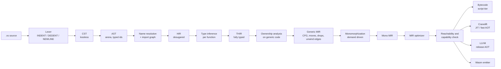

# 02. Compiler architecture

## 2.1 Pipeline



Everything left of `Generic MIR` is **target independent and library
independent**. Everything from `Mono MIR` onward knows the target. Nothing
in the front end ever sees a target triple.

## 2.2 Stage contracts

Each stage has an input invariant it may rely on and an output invariant it
must establish. A violated invariant is a compiler bug and is caught by a
verifier pass that runs in debug builds and in CI (`verse-verify`).

| Stage | Input invariant | Output invariant | Errors it owns |
|-------|-----------------|------------------|----------------|
| Lexer | valid UTF-8 | balanced `INDENT`/`DEDENT`, tabs rejected, every byte covered by a token or trivia | bad indentation, unterminated text, invalid escapes |
| Parser | token stream | CST whose text round-trips byte for byte; error nodes where parsing failed, never a panic | syntax errors, with recovery at line and block boundaries |
| AST lowering | CST | each node has a stable `NodeId` and span; trivia discarded | none |
| Name resolution | AST of all modules in a package | every identifier is a `Def` id or a local id; the no-shadowing rule (§3.9) enforced; modules may import each other, but module-level constants initialise without a cycle (§12.2) | unknown name, hidden name, a constant initialisation cycle (V0310), visibility |
| HIR lowering | resolved AST | no sugar: `otherwise`, `?`, `if…is`, key-path lambdas, postfix guards, string interpolation, `with` and `for` are expanded to a small core. Optional-lifting positions (§8.1) are marked but not yet typed | none |
| Type inference | HIR | every expression has a type or a recorded unresolved variable; unresolved variables become the "cannot infer, annotate here" error (§4.2 rule 4) | type errors, missing annotations, optional misuse, non-exhaustive patterns |
| Ownership | THIR | every use is classified as move, copy, borrow, mut borrow, or view; every drop point is known; see 2.4 | use after move, borrow rules, `Copy` bound errors, resource and task rules (`with`, views sent to tasks) |
| MIR build | THIR plus ownership facts | CFG of basic blocks; locals typed; explicit `Move`, `Copy`, `Drop`, unwind edges | none |
| Monomorphization | generic MIR | no type parameters, no structural constraints, no `Show` or `Eq` left abstract; trait calls resolved except calls through a trait name used as a type | none |
| Optimizer | mono MIR | semantics preserved; verifier passes after every pass in debug builds | none |
| Reachability and capability check | optimized mono MIR (in script mode, the pre-pass of 2.6) | the set of functions, types, vtables, constants and platform capabilities actually used, from the program's entry points; every used capability is granted and provided by the target, or the build or run stops before any code runs | capability errors (V09xx): a reachable capability that is not granted, that the target cannot provide, or that a package does not declare; the `--no-heap` checks (allocation, channel capacity, bounded `spawn`) |
| Backends | reachable mono MIR | an artifact for the selected target | target limits that are not capabilities (for example "no threads on this target", a recursive wait on a state-machine target) |

The codes each stage reports are listed in
[16 §16.2.1](../reference/diagnostics-catalog.md#1621-families-by-pass).

## 2.3 Data structures

Choices made for speed and for cache behavior. All are **assumptions** until
the M0 benchmarks run ([11](../roadmap.md)).

- **Interned strings and types.** Identifiers, text literals and types are
  interned to `u32` ids. Type equality is integer equality.
- **Arenas with typed indices.** AST, HIR, THIR and MIR nodes live in
  per-module arenas (`Vec<Node>` addressed by `NodeId(u32)`). No `Rc`, no
  per-node heap allocation. Freed all at once.
- **Lossless syntax tree for tools only.** The formatter and language server
  use a CST (green tree, structurally shared, cheap to re-parse after an
  edit). The compiler proper uses the AST, so the hot path never touches
  trivia.
- **Struct of arrays for MIR.** Statements and terminators are stored in
  flat arrays per function. Basic blocks hold index ranges. Passes iterate
  linearly.
- **Spans** are `(file_id: u32, start: u32, end: u32)`. Line and column are
  computed on demand from a per-file line table.

## 2.4 The ownership pass

This is the pass with the most unusual contract, so it is specified here.

**Where it runs.** On THIR of the generic definition, once per function.
Never again for specializations (spec §4.2 rule 9). Consequence: ownership
errors are reported at the definition, and a call site can fail only on an
unmet written or inferred bound (§4.2 rule 9, final paragraph).

**What it computes.**

1. **Liveness and last use** for every local, by backward dataflow over the
   function's CFG. Needed because `b = a`, `for x in items`, pattern bindings
   and chain results are views when the source is used later and owners at the
   source's last use (§4.9, §18.10).
2. **Place states**: each place (local, field path, element-in-place) is in
   one of `Owned`, `MovedAt(site)`, `Borrowed(kind)`, `View(of, until)`.
   Conditional moves produce **drop flags**, as in Rust MIR drop elaboration.
3. **Second-class borrow rules**. Because borrows cannot be stored, returned
   or sent to a task, a borrow's lifetime is the dynamic extent of one call.
   The check is therefore a local rule, not a lifetime solver:
   - a `mut` argument is exclusive for the call, with arguments evaluated
     first and the borrow starting after (§4.10 example);
   - a view cannot flow into a stored position, a return, or `spawn`.
4. **Chain classification**: adapters such as `filter` and `zip` pass views;
   the chain end decides (§9.5, §18.10). The pass records, for each chain, the
   owning step that collects it.
5. **Inferred `Copy` bounds** for unannotated getters, written to the
   function's interface record (and to `verse.api` for exports).
6. **Explanations.** Every ownership error carries a structured explanation:
   the move site, the later use that kept a source alive, the rule number, and
   the suggested fix. This is a hard requirement from spec §18.10 ("error
   messages carry the burden") and it is also what the debugger shows
   (see [08](debugging.md)).

**Why a custom pass and not a borrow checker port.** Rust's borrow checker
solves lifetimes across stored references. Verse has none, so a full
region-inference engine would be unused complexity ([ADR-0002](../decisions/0002-ownership-on-generic-code.md) explains why we
do not copy it; compare Hylo and Swift's ownership model, where
second-class values also make the analysis local).

## 2.5 Type inference

Hindley–Milner style unification with trait, callable and structural
constraints, solved **per function** and **per module**.

- **Unannotated parameters** become implicit generics with a constraint set
  (spec §4.2 rule 1). Constraints are `Trait(T)`, `Callable(T, args, ret)`,
  `HasField(T, name, FieldTy)`, `HasMethod(T, name, sig)`.
- **Structural constraints** (`HasField`, `HasMethod`) are the unusual part.
  They are solved at the call site against a concrete type, and they never
  appear in user syntax (spec: "inferred only").
- **Recursion** requires annotations (rule 3), so inference never needs a
  fix-point across a call cycle. Strongly connected components of the call
  graph are checked to ensure every cycle has an annotated entry.
- **Numeric literals** default after solving: any literal type variable still
  unconstrained becomes `Int` or `Float` (rule 2).
- **Module boundary.** An exported function's inferred signature is compared
  with `verse.api`. Importers use only `verse.api` (§16.4), so a module can be
  checked without the source of its dependencies. This is what lets us
  compile packages independently and in parallel.
- **Fallible returns** are inferred from `?` and normalized as in §4.6.

## 2.6 Monomorphization

Spec §4.2 requires "specialized code for each concrete type used".

- **Demand driven.** Starting from the entry statements (or from exports when
  building a library) and from tests, instantiate a function when a call
  instantiates it. This gives exact reachability for free.
- **Instance key** is `(DefId, [TypeId])` after canonicalization.
- **Code bloat controls**: identical instances after layout erasure (for
  example `List<Int>` and `List<Float>` for pure moves, both 8 bytes) can be
  merged by the linker (identical code folding). A trait name used as a type
  (spec §10.3) is the user-visible escape hatch for compile-time-sensitive
  code: it is one shared body instead of one copy per type.
- **Script mode** instantiates **code** lazily at first call, so bytecode
  generation and optimization scale with what runs. Before tier 0
  starts, running a file performs a cheap whole-program **reachability pre-pass**
  from the entry statements: it walks the generic MIR with type arguments
  substituted (resolving trait calls and vtable slots), builds no bytecode and
  runs no optimizer pass, and caches its result per module. The **capability
  check** runs right after it, exactly as it runs after full reachability in a
  compiled build, so a missing or denied capability fails with the same V09xx
  diagnostic in every tier before the first instruction. Only the cost of the
  pre-pass scales with what is reachable; instances are still compiled lazily
  ([14 §14.6](bytecode-and-vm.md#146-calls-and-lazy-instantiation)).

## 2.7 Incremental and parallel compilation

- **Query architecture.** Every pure function of its inputs is a memoized
  query keyed by content hash (the Salsa model used by rust-analyzer). Edits
  invalidate only dependent queries.
- **Unit of parallelism** is the function body for inference, ownership and MIR
  build; the module for parsing and resolution; the instance for optimization
  and code generation.
- **Persistent cache.** `.verse/cache/` stores parsed modules, signatures and
  object code keyed by `blake3(source, compiler version, flags, verse.api of
  imports)`. `verse x.vs` on an unchanged script skips straight to execution.
- **Deterministic output.** Same inputs and `verse.lock` give the same bytes
  (spec §16.3): no timestamps, no hash-map iteration order leaking into output,
  stable instance ordering.

## 2.8 Diagnostics

Diagnostics are data first, text second.

```
Diagnostic {
  code:      "V0412"                 // stable, documented, never reused
  severity:  error | warning | note
  message:   plain language           // spec §16.2 style
  primary:   Span + label
  secondary: [Span + label]
  rule:      "§4.9"                   // the spec section that defines the rule
  help:      [Suggestion]             // machine-applicable edits when safe
  facts:     { ... }                  // structured: move site, later use, bound name
}
```

The terminal renderer, the language server, `verse check --json`, and the debug
adapter all consume the same record. `verse explain V0412` prints the long
form. Machine-applicable suggestions (`otherwise ""`, `.copy()`) carry an edit
so editors and other tools can apply them without parsing prose.

## 2.9 Crate layout

```
verse/
  crates/
    verse-syntax      lexer, CST, parser, AST
    verse-hir         resolution, HIR, THIR
    verse-types       inference, trait solving, constraints
    verse-own         ownership analysis
    verse-mir         MIR definition, build, verifier, optimizer, mono
    verse-reach       reachability and capability analysis
    verse-ffi         native plugins: loading and call stubs for the VM, link lines
    verse-bc          bytecode compiler and interpreter
    verse-cl          Cranelift backend
    verse-llvm        LLVM backend (optional feature)
    verse-wasm        WebAssembly emitter
    verse-rt          runtime, split into feature slices
    verse-pkg         verse.toml, lock, registry client, verse.api
    verse-fmt         formatter (CST based)
    verse-lsp         language server
    verse-dbg         debugger core, record and replay, DAP adapter
    verse-cli         the `verse` binary
  std/                the standard library, in Verse
  tests/              conformance, differential, golden, fuzz corpora
  bench/              benchmark programs and harness
```

The dependency direction is strictly downward in the order above. A back edge
(for example, `verse-types` importing a backend) is a build error enforced by
`cargo deny`-style checks in CI.
