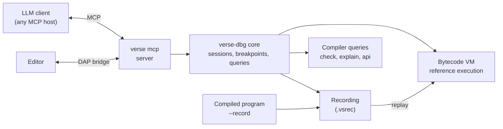

# 08. Debugging and MCP

Requirement R7: debugging that is easy for people and, above all, easy for
LLMs to navigate step by step, in the spirit of the Model Context Protocol
(MCP). Status: **agreed** (Michelangelo, Bob). Technical design: Bob. Event names and message
wording (section 8.7): Michelangelo.

## 8.1 What makes debugging hard for an LLM

| Problem with classic debuggers | Design answer |
|--------------------------------|---------------|
| Output is unbounded text and floods the context window | every tool call takes a **budget** (maximum items, depth, bytes) and returns a continuation token |
| State is shown as machine memory (addresses, registers) | state is shown as **Verse values**, with names, types and **ownership state** |
| One step at a time with no memory | **time travel**: step back, jump to any recorded step, search the history |
| "What happened?" needs many manual steps | **question tools**: why was this moved, who changed this field, why did this panic |
| Free-form text is ambiguous | every result is **structured JSON** with stable ids, plus a one-line plain-language summary in the compiler's wording |
| Non-reproducible bugs | **deterministic record and replay** of the whole run, including task scheduling |

## 8.2 Architecture



- **Everything debuggable runs in the VM.** It is the semantic reference
  ([ADR-0008](../decisions/0008-tiered-execution.md)) and can expose every local and
  every step cheaply.
- **A compiled program is debugged by replay.** Build with `--record` (or run
  a program with `VERSE_RECORD=file`). The runtime logs only **nondeterministic
  inputs**: results of capability calls (clock, random, file and network
  reads, environment), scheduler decisions, and external signals. Replaying
  that log in the VM reproduces the run exactly, with full inspection. This
  works because script and compiled modes behave identically (agreed rule) and
  all outside-world access goes through capabilities ([05](runtime.md), 5.6).
- **Native debuggers still work.** The compiler emits DWARF and a Verse debug
  map, so `gdb` and `lldb` can show Verse names. This is a secondary path.

## 8.3 The MCP server

`verse mcp` speaks MCP over stdio (default) or HTTP. It is a normal
subcommand, so installing the toolchain installs it.

### Core set

An LLM needs only a small set to debug well. These are the **core tools**; the
rest of this section are optional extras that a client may ignore:
`debug_launch`, `debug_continue`, `debug_step`, `debug_back`, `debug_break`,
`debug_break_on`, `inspect_locals`, `inspect_value`, `inspect_stack`,
`inspect_tasks`, `evaluate`, `why_moved`, `why_view`, `why_changed`,
`why_panic`, `debug_stop`. Every response names the next useful tools in
`next`, so a client can start with the core set and discover the others.

### Tools: running and stopping

| Tool | Purpose | Key inputs | Returns |
|------|---------|------------|---------|
| `debug_launch` | start a program in the VM (or open a recording) | `file`, `args`, `record: bool`, `seed` | session id, first stop |
| `debug_continue` | run to the next stop | `session` | stop record |
| `debug_step` | step | `session`, `mode: into / over / out / line / task`, `count` | stop record |
| `debug_back` | step backward (recorded sessions) | `session`, `mode`, `count` | stop record |
| `debug_goto` | jump to a recorded step or event | `session`, `step` or `event_id` | stop record |
| `debug_break` | set, list, clear breakpoints | `file:line`, `function`, `condition` (a Verse expression), `hit_count`, `logpoint` (a text template) | breakpoint ids |
| `debug_break_on` | break on a kind of event | `kind: panicked / propagated / moved / reassigned / dropped / spawned / waited / sent / overflowed / ...` (same words as events, §8.7); optional filter such as a name or an error type | breakpoint id |
| `debug_stop` | end the session | `session` | summary |

### Tools: looking

| Tool | Purpose | Notes |
|------|---------|-------|
| `inspect_locals` | locals, parameters and their values | paged; values are structured (below) |
| `inspect_value` | expand one value by id | depth and size budgets |
| `inspect_stack` | the call stack of one task | each call has a source span and a one-line summary |
| `inspect_tasks` | the task tree: state, parent, what each waits for | shows deadlock candidates |
| `evaluate` | evaluate a **pure** Verse expression in a call | side-effecting calls are refused |
| `source` | show source around a span | with line numbers and the current marker |
| `diff_stops` | compare two stops | returns only the values that changed |

### Tools: asking why

| Tool | Question it answers |
|------|---------------------|
| `why_moved` | "where was `x` moved, and what is using it now?" |
| `why_alive` | "which owner keeps this value alive?" (also shows `Shared` counts) |
| `why_changed` | "which step last changed `x.field`?" (time travel) |
| `why_view` | "which later use kept this source alive, so that this binding is only a view?" (§18.10) |
| `why_panic` | "what led to this panic?": the failing check, values involved, the last N relevant events |
| `why_blocked` | "what is this task waiting for, and who could wake it?" |
| `history` | all writes to a place, or all events of a kind, as a bounded list |

### Tools: the compiler, through the same server

| Tool | Purpose |
|------|---------|
| `check` | type-check a file or project; structured diagnostics |
| `explain` | long explanation of a diagnostic code with examples |
| `apply_fix` | apply a machine-applicable suggestion from a diagnostic |
| `format` | `verse fmt` on a file |
| `signature` | inferred signature of a function (what `verse api` records) |
| `run_tests` | run `test` blocks, with failing assertions as structured results |
| `size_report` | why an item is in the build ([06](stdlib-and-shaking.md)) |

### Resources (read-only, for context)

`verse://spec/<section>` (the language specification), `verse://diag/<code>`
(diagnostic explanations), `verse://api/<module>` (module interfaces), and
`verse://session/<id>/trace` (the event stream so far).

## 8.4 Data shapes

### Stop record

```json
{
  "session": "s1",
  "step": 1842,
  "reason": "breakpoint",
  "task": "t3",
  "call": {"function": "parse_age", "file": "ages.vs", "line": 12, "column": 5},
  "summary": "Stopped at a breakpoint at line 12 in `parse_age`, task t3.",
  "source": [{"line": 11, "text": "..."}, {"line": 12, "text": "...", "current": true}],
  "changed_since_last_stop": ["age"],
  "next": ["debug_step", "inspect_locals", "why_moved"]
}
```

### Value

```json
{
  "id": "v481",
  "name": "person",
  "type": "Person",
  "state": "owned",
  "kind": "record",
  "summary": "Person(name: \"Ana\", age: 30, email: \"ana@example.com\")",
  "fields": [
    {"name": "name",  "ref": "v482"},
    {"name": "age",   "value": 30},
    {"name": "email", "ref": "v483"}
  ],
  "truncated": false
}
```

- Optional values carry `presence: present or none` and fallible values `result: ok or error` (§8.7); stop reasons are listed in §8.7.
- `state` is one of `owned`, `moved` (with `moved_at`: a span and step),
  `borrowed`, `exclusive`, `view` (with `of` and `until`), `dropped`. These
  are exactly the states the ownership pass uses ([02](compiler-architecture.md),
  2.4), so the debugger and the compiler talk about the same thing.
- Values have **stable ids within a session**, so a client can say "expand
  `v481`" without repeating a path.
- Large values are always truncated by budget, with `truncated: true` and a
  continuation token. Text longer than the budget is shown as head plus length.

### Event stream

The same events feed breakpoints, the trace and the recording:

```json
{"step": 1840, "task": "t3", "event": "reassigned", "name": "count",
 "from": 4, "to": 5, "at": {"file": "ages.vs", "line": 9}}
{"step": 1841, "task": "t3", "event": "moved", "name": "guest",
 "to": "add_guest", "at": {"file": "ages.vs", "line": 21}}
```

Each event has a stable `event` name and a one-line `text` rendering in the
compiler's wording (section 8.7).

#### Rendered values

A `tool` plugin that declares `renders = ["TypeName"]` in `plugin.toml` can
supply a short description of values of that type. The description is added to
the value record next to the built-in one. It never replaces it.

```json
{
  "name": "scores",
  "type": "Histogram",
  "state": "owned",
  "summary": "Histogram(buckets: 12, total: 340)",
  "rendered": "340 samples in 12 buckets, most in 40 to 50",
  "rendered_by": "stats-view"
}
```

- **Where it runs.** Only inside the debugger (`verse mcp`). It never runs in
  the program and cannot change what the program does, so script and compile
  modes stay identical.
- **Input.** The value record of this section, cut to the depth and size that
  the debug call asked for. It has no addresses and no pointers.
- **Output.** One string of at most 25 words, plain and in the present tense.
  The host checks it against the "don't say" table of §8.7. A string that fails
  the check or is too long is dropped, the built-in `summary` is used, and the
  user sees one warning for that type.
- **Budget.** 1 million fuel units, 50 ms and 16 MiB per call. A call that stops
  falls back to the built-in `summary`.
- **No capabilities.** A renderer can read no file and no input.
- **Recordings.** Record and replay stores raw values only, so a recording does
  not depend on any renderer. Rendering happens when a value is asked for.
- **Both lines are always present.** `summary` is always there, so a client that
  does not know about renderers still reads a full description.

Fields added to the value record: `rendered` (text, optional) and
`rendered_by` (the plugin name, present exactly when `rendered` is).

## 8.5 Deterministic record and replay

- **What is recorded**: capability results (with their arguments, for
  validation), scheduler choices (which task ran, when it yielded, wake-up
  order), thread interleavings of `Guarded` lock acquisitions, random seeds,
  and signals. Not recorded: pure computation, which the VM reproduces.
- **Seeded scheduler mode**: `--seed N` makes scheduling deterministic without
  a recording, so a failing concurrent test can be re-run.
- **Size**: a recording is proportional to the number of nondeterministic
  events, not to run time. Target: under 100 bytes per event record, before
  compression, then compressed with zstd. A capability result larger than 64
  bytes is kept in a separate blob block that the event refers to, and is not
  counted in the 100 bytes (14 §14.10). Long-running programs use a **ring buffer**: only the last N
  events plus periodic snapshots are kept, enough to explain a crash.
- **A step** is one MIR statement or terminator, counted in tier 0 on
  unoptimized mono MIR. A fused VM instruction counts the MIR items it
  fuses. Steps exist only in the VM: a recording is indexed by event ordinal, so a
  compiled tier needs no step counter, and a replay always runs at optimization
  level 0 so that step numbers mean the same for every recording. `debug_goto`
  with a `step` therefore works on recordings replayed in the VM, and `event_id`
  works everywhere.
- **Time travel in the VM** uses snapshots at intervals and re-execution forward
  from the nearest snapshot to reach any step (the approach of rr and
  Pernosco, scaled down). Backward step cost is bounded by the snapshot
  interval.
- **Requirements this places on the language and runtime**: `Set` iteration
  must be deterministic; hash seeds must be fixed in record mode;
  floating-point must be bit-identical across tiers (see
  [10](testing-and-verification.md), 10.3); instrumentation must not change
  behavior.

## 8.6 Panics and crashes as first-class data

On any panic, a native or VM run writes a **panic report**, with no debugger
attached, in the same shape that `why_panic` returns:

```json
{
  "event": "panicked",
  "kind": "index_out_of_bounds",
  "text": "list index 7 is out of bounds for a list of length 3",
  "at": {"file": "scores.vs", "line": 18, "column": 14},
  "task": "main",
  "values": [{"name": "scores", "summary": "[10, 20, 30]"}, {"name": "i", "value": 7}],
  "stack": [{"function": "best", "line": 18}, {"function": "<script>", "line": 40}],
  "last_events": ["..."]
}
```

Humans see it rendered as text. `VERSE_PANIC=json` prints the JSON to standard
error. A CI system or an LLM can read it with no tooling.

## 8.7 Vocabulary and wording (owned by Michelangelo)

### Rules

1. **One vocabulary.** Debug events and compiler diagnostics use the same
   names and wording. A move is "moved" in both. A reassignment is
   "reassigned" in both. The vocabulary file `events.toml` is the single
   source; the compiler fails to build if an event has no entry.
2. **Events are past-tense verbs in `snake_case`**, one word where possible,
   with the thing they happened to in a field: `reassigned` with `name: "count"`,
   never `binding_reassigned`. Tools are verbs or `why_` questions. Break kinds
   are the same words as events.
3. **Say where, why and what next.** Every stop and answer states the
   position, the reason, and the tools that make sense now (`next`).
4. **Nothing is cut silently.** A cut value says how much was shown and how to
   get the rest.
5. **A value never claims more than the runtime knows.** An unrecorded field is
   `unknown`, never guessed.

### Words: say and don't say

| Say | Don't say | Because |
|-----|-----------|---------|
| binding, `mut` binding | variable | immutable unless `mut` (§3.9) |
| owner, owned | holder | one owner per value (§4.10) |
| view, borrow, exclusive borrow | reference, pointer, alias | borrows are second-class (§5.3) |
| moved (to …) | transferred, invalidated | the spec word, and a move has a destination |
| copied | cloned, duplicated | implicit `Copy` and explicit `.copy()` |
| dropped | freed, collected | there is no collector |
| cleaned up | closed, finalized | `Cleanup` ran (§13) |
| `none`, present | null, nil, `some` | optionals have no null and no `some` (§8.1) |
| error value, propagated | exception, thrown, caught | errors are values |
| panicked, stopped | crashed | a panic stops the task (§8.5) |
| task | thread, coroutine | §11 |
| stack, call | frame | the spec says "stack trace" and "call" |
| reassigned | assigned (an existing name), mutated | reassignment must look different from a new binding (§3.9) |
| new binding | declaration | there is no `let` |

### Event list (the vocabulary file's keys)

| Event | Fields | Template |
|-------|--------|----------|
| `bound` | `name`, `value` | "`{name}` bound to {value}" |
| `reassigned` | `name`, `from`, `to` | "`{name}` reassigned from {from} to {to}" |
| `copied` | `name`, `how: implicit or copy` | "`{name}` copied" |
| `moved` | `name`, `to` | "`{name}` moved to {to}" |
| `borrowed` | `name`, `by` | "`{name}` borrowed by {by}" |
| `dropped` | `name` | "`{name}` dropped" |
| `cleaned_up` | `name` | "`{name}` cleaned up" |
| `called`, `returned` | `function`, `value`; `called` adds `foreign: true` for a foreign call (0.2 `extern`) | "{function} called" / "{function} returned {value}"; a foreign call reads "{function} called (foreign code)" |
| `propagated` | `value`, `function` | "`?` left {function} with {value}" |
| `panicked` | `kind`, `text` | "{text}" |
| `spawned`, `finished` | `task`, `function` | "task {task} started {function}" / "task {task} finished" |
| `waited` | `task`, `on` | "task {task} waited for {on}" |
| `sent`, `received`, `closed` | `channel`, `value` | "sent {value}" / "received {value}" / "channel closed" |
| `overflowed` | `op`, `type` | "{op} overflowed `{type}`" |
| `asserted` | `text`, `passed` | "assert {text}: {passed}" |

### Value states

`owned`, `moved` (with `moved_at`, `moved_to`), `view` (with `of`, `until`),
`borrowed` (a parameter seen by a call), `exclusive` (a `mut` parameter during
a call), `dropped`, `not_yet_bound`. A `mut` binding adds `mutable: true` and
`reassigned_at`. An optional adds `presence: present or none`; a fallible
value adds `result: ok or error`. A value that crossed a foreign call adds
`note: from_foreign`, shown as "came from a foreign call" (0.2 `extern`, E10).

### Stop reasons

`breakpoint`, `step_done`, `panicked`, `assert_failed`, `propagated`, `moved`,
`reassigned`, `watch_changed`, `deadlocked`, `exited`, `paused`.

### Wording of a stop or answer

- `summary` is one sentence, 25 words at most, present tense, about the
  program, with names in backticks and a position. It says what happened and its
  cause: "Stopped in `parse_args` at line 44: `?` returned an error because
  `--top` has no value." It does not say "paused" and does not use "you".
- Debugger errors use codes `D0xxx` (never reused) and the same sentence rules:
  "D0101: no program is running; start one with `debug_launch`".
- Cuts: a value after 200 characters, a list after 20 elements, a response
  after 4,000 characters, always with
  `{"shown": 20, "total": 312, "more": "…"}`.

### Wording tests

Golden tests render each stop, answer and error from fixed records and fail on
any word from the "don't say" column. They also check that every diagnostic
and every event with the same name has the same template.

## 8.8 Editor integration

- **DAP bridge**: `verse mcp --dap` (or `verse dap`) exposes the same session
  as the Debug Adapter Protocol for VS Code and other editors.
- **Language server**: shows ownership state and inferred types inline, using
  the same queries (`signature`, `check`).
- **Terminal**: `verse debug file.vs` is a small interactive front end over the
  same core, for people.

## 8.9 Safety

- `evaluate` accepts only expressions the compiler proves pure; no capability
  calls, no spawning.
- The MCP server is read-only toward the file system except for `apply_fix`
  and `format`, which are explicit and return a diff.
- Capabilities in a debugged program are the same as in a normal run. `--deny`
  flags apply ([05](runtime.md), 5.6).
- Recordings may contain secrets (file contents, network bytes). They are
  stored with owner-only permissions and `verse record redact` removes chosen
  capability results.
