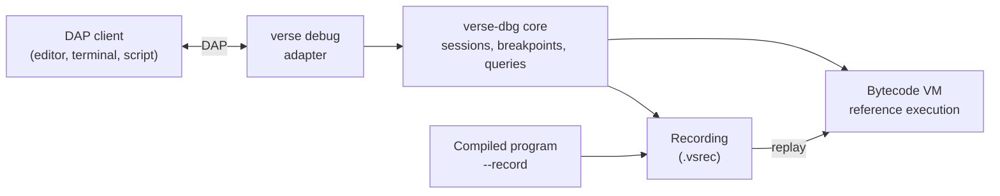

# 08. Debugging

Requirement R7: debugging that is easy. The debugger speaks the Debug Adapter
Protocol (DAP), so any DAP client can drive it: an editor, a terminal front
end, or a script. Verse-specific features are DAP extensions that a client
may ignore.

## 8.1 What the debugger shows

| Problem with classic debuggers | Design answer |
|--------------------------------|---------------|
| State is shown as machine memory (addresses, registers) | state is shown as **Verse values**, with names, types and **ownership state** |
| One step at a time, forward only | **time travel**: step back, run backward, jump to any recorded step |
| Free-form text is ambiguous | every stop, value and panic uses the compiler's words and carries structured data |
| Non-reproducible bugs | **deterministic record and replay** of the whole run, including task scheduling |
| Each editor needs its own integration | one protocol, **DAP**, which editors and other tools already speak |

## 8.2 Architecture



- **Everything debuggable runs in the VM.** It is the semantic reference
  ([ADR-0008](../decisions/0008-tiered-execution.md)) and can expose every local and
  every step cheaply.
- **A compiled program is debugged by replay.** Build with `--record` (or run
  a program with `VERSE_RECORD=file`). The runtime logs only **nondeterministic
  inputs**: results of capability calls (clock, random, file and network
  reads, environment), scheduler decisions, and external signals. Replaying
  that log in the VM reproduces the run exactly, with full inspection. This
  works because script and compiled modes behave identically and
  all outside-world access goes through capabilities ([05](runtime.md), 5.6).
- **Native debuggers still work.** The compiler emits DWARF and a Verse debug
  map, so `gdb` and `lldb` can show Verse names. This is a secondary path.

## 8.3 The debug adapter

`verse debug` is the debug adapter. It is a normal subcommand, so installing
the toolchain installs it.

| Command | What it does |
|---------|--------------|
| `verse debug` | serves DAP on standard input and output; this is how an editor starts it |
| `verse debug --port 4711` | serves DAP on a local TCP port, one session per connection |
| `verse debug app.vs [args…]` | as `verse debug`, with `app.vs` and its arguments as the default `program` and `args` of `launch` |

The program's own output reaches the client as `output` events with category
`stdout` or `stderr`, never on the adapter's standard output.

### Launch and attach

`launch` takes these arguments. All are optional except `program`, unless
`verse debug` was given a file.

| Argument | Meaning |
|----------|---------|
| `program` | the `.vs` file or package folder to run, as in `verse app.vs` |
| `args` | the program's arguments (spec §12.5) |
| `record` | `true` records the run, so `stepBack` and `reverseContinue` work (§8.5) |
| `seed` | the scheduler seed (§8.5) |
| `replay` | a `.vsrec` file to replay in the VM instead of starting a new run |
| `deny` | capabilities to refuse, as `--deny` ([05](runtime.md), 5.6) |
| `stopOnEntry` | stop before the first statement |

`attach` takes `pid`: a program started with `verse --debug app.vs` listens on
a local socket named after its process id, and the adapter connects to it.
Only VM programs accept `attach`. A compiled program is debugged by replay.

### Standard requests

These are the DAP requests the adapter supports. Its `initialize` response
sets `supportsConfigurationDoneRequest`, `supportsConditionalBreakpoints`,
`supportsHitConditionalBreakpoints`, `supportsLogPoints`,
`supportsFunctionBreakpoints`, `supportsDataBreakpoints`,
`supportsEvaluateForHovers`, `supportsExceptionInfoRequest`,
`supportsTerminateRequest` and `supportsStepBack`. It also lists the exception
filters below in `exceptionBreakpointFilters`.

| Request | Verse behaviour |
|---------|-----------------|
| `initialize`, `configurationDone`, `launch`, `attach`, `disconnect`, `terminate` | start and end a session |
| `setBreakpoints` | line breakpoints, with `condition` (a pure Verse expression), `hitCondition` and `logMessage` (a text template with `{expr}` parts) |
| `setFunctionBreakpoints` | break when a function is called, by its qualified name |
| `setDataBreakpoints` | watch a binding or a field: stop when it is reassigned, changed or moved |
| `setExceptionBreakpoints` | the filters `panicked`, `propagated` (a `?` left a function with an error value) and `assert_failed` |
| `continue`, `next`, `stepIn`, `stepOut`, `pause` | run and step; `next` steps over a call |
| `stepBack`, `reverseContinue` | step or run backward in a recorded session (§8.5) |
| `threads` | one thread per live Verse task; the name says the task id, its function and what it waits for |
| `stackTrace` | the calls of one task, each with a source span |
| `scopes` | `Locals` and `Parameters` of a call, plus `Task` for the task's state |
| `variables` | Verse values with ownership state (§8.4); lists and maps page with `start` and `count` |
| `evaluate` | a **pure** Verse expression in a call; side-effecting calls are refused |
| `exceptionInfo` | the panic report of the current stop (§8.6) |
| `source` | the text of a source file, for clients that cannot read it |

`goto`, `setVariable`, `setExpression` and `restartFrame` are not supported.
Changing a running program's state would break replay.

## 8.4 Values and stops

### Values

A `variables` response is a list of DAP `Variable` objects. `value` is a
one-line summary in the compiler's words, and `type` is the Verse type.
Records, variants, lists, maps, sets and tuples have a `variablesReference`
to expand them. Each `Variable` also carries a `verse` object with the
ownership state:

```json
{
  "name": "guest",
  "value": "moved to `add_guest` at line 21",
  "type": "Person",
  "variablesReference": 0,
  "verse": {"state": "moved", "moved_to": "add_guest",
            "moved_at": {"file": "party.vs", "line": 21, "column": 9}}
}
```

- `state` is one of the value states of §8.7. These are exactly the states
  the ownership pass uses ([02](compiler-architecture.md), 2.4), so the
  debugger and the compiler talk about the same thing.
- An immutable binding has `presentationHint.attributes` `["readOnly"]`.
- A moved or dropped value has no `variablesReference`: there is nothing left
  to expand.
- Text longer than 200 characters is shown as head plus length. A list or map
  reports `indexedVariables` or `namedVariables`, so a client fetches it in
  pages. Nothing is cut silently.

### Stops

Every stop is a DAP `stopped` event. `reason` is a DAP reason, `description`
is the one-sentence summary of §8.7, and `verse` carries the Verse stop reason
and the step:

| Verse stop reason | DAP `reason` |
|-------------------|--------------|
| `breakpoint` | `breakpoint`, or `function breakpoint` |
| `step_done` | `step` |
| `panicked`, `assert_failed`, `propagated` | `exception` |
| `moved`, `reassigned`, `watch_changed` | `data breakpoint` |
| `paused` | `pause` |
| `deadlocked` | `deadlocked` |
| `exited` | none: the adapter sends `exited` and `terminated` events |

`allThreadsStopped` is always `true`: a stop halts every task, so the task
tree is consistent when inspected.

## 8.5 Deterministic record and replay

- **What is recorded**: capability results (with their arguments, for
  validation), scheduler choices (which task ran, when it yielded, wake-up
  order), thread interleavings of `Guarded` lock acquisitions, random seeds,
  and signals. Not recorded: pure computation, which the VM reproduces.
- **Seeded scheduler mode**: `--seed N` (or `seed` in `launch`) makes
  scheduling deterministic without a recording, so a failing concurrent test
  can be re-run.
- **Size**: a recording is proportional to the number of nondeterministic
  events, not to run time. Target: under 100 bytes per event record, before
  compression, then compressed with zstd. A capability result larger than 64
  bytes is kept in a separate blob block that the event refers to, and is not
  counted in the 100 bytes (14 §14.10). Long-running programs use a **ring buffer**: only the last N
  events plus periodic snapshots are kept, enough to explain a crash.
- **A step** is one MIR statement or terminator, counted in tier 0 on
  unoptimized mono MIR. A fused VM instruction counts the MIR items it
  fuses. Steps exist only in the VM: a recording is indexed by event ordinal, so a
  compiled tier needs no step counter, and a replay always runs at optimization
  level 0 so that step numbers mean the same for every recording. `verse/goto`
  with a `step` therefore works on recordings replayed in the VM, and with an
  `event` it works everywhere.
- **Reverse execution is standard DAP.** `stepBack` goes to the previous step
  of the same granularity, and `reverseContinue` runs backward to the previous
  breakpoint, data breakpoint or exception stop. "Which step last changed
  `x.field`?" is a data breakpoint on `x.field` followed by `reverseContinue`.
- **Time travel in the VM** uses snapshots at intervals and re-execution forward
  from the nearest snapshot to reach any step (the approach of rr and
  Pernosco, scaled down). Backward step cost is bounded by the snapshot
  interval.
- **Requirements this places on the language and runtime**: `Set` iteration
  must be deterministic; hash seeds must be fixed in record mode;
  floating-point must be bit-identical across tiers (see
  [10](testing-and-verification.md), 10.3); instrumentation must not change
  behavior.

## 8.6 Panics and crashes as first-class data

On any panic, a native or VM run writes a **panic report**, with no debugger
attached:

```json
{
  "event": "panicked",
  "kind": "index_out_of_bounds",
  "text": "list index 7 is out of bounds for a list of length 3",
  "at": {"file": "scores.vs", "line": 18, "column": 14},
  "task": "main",
  "values": [{"name": "scores", "summary": "[10, 20, 30]"}, {"name": "i", "value": 7}],
  "stack": [{"function": "best", "file": "scores.vs", "line": 18}, {"function": "<script>", "file": "scores.vs", "line": 40}],
  "last_events": ["..."]
}
```

Humans see it rendered as text. `VERSE_PANIC=json` prints the JSON to standard
error, so a CI system can read it with no tooling. Every build fills `stack`,
and repeated calls in it are folded as
[16 §16.6](../reference/diagnostics-catalog.md#166-run-time-panics) says.
`values` and `last_events` come from the `debug` runtime slice
([05 §5.1](runtime.md#51-feature-slices)), so a build without it prints them
as empty lists.

In a debug session, a panic stops with `reason: "exception"`, and
`exceptionInfo` returns the same report:

| `exceptionInfo` field | Content |
|-----------------------|---------|
| `exceptionId` | the panic `kind`, such as `index_out_of_bounds`, or `assert_failed` or `propagated` |
| `description` | the report's `text` |
| `breakMode` | `unhandled` for a panic, `always` for a filter stop |
| `details.stackTrace` | the report's `stack`, one call per line |
| `verse` | the whole panic report as above |

Replaying the recording of a crashed compiled program stops at the same panic
with the same report, and `stepBack` walks to its cause.

## 8.7 Vocabulary and wording

### Rules

1. **One vocabulary.** Debug events and compiler diagnostics use the same
   names and wording. A move is "moved" in both. A reassignment is
   "reassigned" in both. The vocabulary file
   [`events.toml`](../reference/events.toml) is the single source; the
   compiler fails to build if an event has no entry.
2. **Events are past-tense verbs in `snake_case`**, one word where possible,
   with the thing they happened to in a field: `reassigned` with `name: "count"`,
   never `binding_reassigned`. Exception filters and stop reasons are the same
   words as events.
3. **Say where and why.** Every stop states the position and the reason.
4. **Nothing is cut silently.** A cut value says how much was shown and how to
   get the rest.
5. **A value never claims more than the runtime knows.** An unrecorded field is
   `unknown`, never guessed.

### Words: say and don't say

| Say | Don't say | Because |
|-----|-----------|---------|
| binding, `mut` binding | variable | immutable unless `mut` (§3.9) |
| owner, owned | holder | one owner per value (§4.10) |
| borrow, exclusive borrow | reference, pointer, alias, view | borrows are second-class (§5.3) |
| moved (to …) | transferred, invalidated | the spec word, and a move has a destination |
| copied | cloned, duplicated | assignment copies a `Copy` value (§4.9); `.copy()` makes a second handle |
| dropped | freed, collected | there is no collector |
| cleaned up | closed, finalized | a drop released a runtime-owned handle (§13.4) |
| `none`, present | null, nil, `some` | optionals have no null and no `some` (§8.1) |
| error value, propagated | exception, thrown, caught | errors are values |
| panicked, stopped | crashed | a panic stops the task (§8.5) |
| task | thread, coroutine | §11 |
| stack, call | frame | the spec says "stack trace" and "call" |
| reassigned | assigned (an existing name), mutated | reassignment must look different from a new binding (§3.9) |
| new binding | declaration | there is no `let` |

DAP's own field and request names (`threads`, `exceptionInfo`,
`variablesReference`) are protocol names, not wording. The rules apply to the
text the adapter writes into them. The exception filters are labelled
"Panics", "Error values leaving a function (`?`)" and "Failed asserts".

### Event list (the vocabulary file's keys)

Events are what the program did. They appear in stop summaries, in the
panic report's `last_events`, in log points and in the recording.

| Event | Fields | Template |
|-------|--------|----------|
| `bound` | `name`, `value` | "`{name}` bound to {value}" |
| `reassigned` | `name`, `from`, `to` | "`{name}` reassigned from {from} to {to}" |
| `copied` | `name`, `how: implicit or copy` | "`{name}` copied" |
| `moved` | `name`, `to` | "`{name}` moved to {to}" |
| `borrowed` | `name`, `by` | "`{name}` borrowed by {by}" |
| `dropped` | `name` | "`{name}` dropped" |
| `cleaned_up` | `name` | "`{name}` cleaned up" |
| `called`, `returned` | `function`, `value`; `called` adds `foreign: true` for a foreign call (`extern`) | "{function} called" / "{function} returned {value}"; a foreign call reads "{function} called (foreign code)" |
| `propagated` | `value`, `function` | "`?` left {function} with {value}" |
| `panicked` | `kind`, `text` | "{text}" |
| `spawned`, `finished` | `task`, `function` | "task {task} started {function}" / "task {task} finished" |
| `waited` | `task`, `on` | "task {task} waited for {on}" |
| `sent`, `received`, `closed` | `channel`, `value` | "sent {value}" / "received {value}" / "channel closed" |
| `overflowed` | `op`, `type` | "{op} overflowed `{type}`" |
| `asserted` | `text`, `passed` | "assert {text}: {passed}" |

### Value states

`owned`, `moved` (with `moved_at`, `moved_to`),
`borrowed` (a parameter seen by a call), `exclusive` (a `mut` parameter during
a call), `dropped`, `not_yet_bound`. A `mut` binding adds `mutable: true` and
`reassigned_at`. An optional adds `presence: present or none`; a fallible
value adds `result: ok or error`. A value that crossed a foreign call adds
`note: from_foreign`, shown as "came from a foreign call" ([07 §7.5](plugins.md#75-ownership-and-lifetime)).

### Stop reasons

`breakpoint`, `step_done`, `panicked`, `assert_failed`, `propagated`, `moved`,
`reassigned`, `watch_changed`, `deadlocked`, `exited`, `paused`.

### Wording of a stop

- The summary is one sentence, 25 words at most, present tense, about the
  program, with names in backticks and a position. It says what happened and its
  cause: "Stopped in `parse_args` at line 44: `?` returned an error because
  `--top` has no value." It does not say "paused" and does not use "you".
- Debugger errors use codes `D0xxx` (never reused) and the same sentence rules.
  A DAP error response carries the code in `message` and in `body.error.id`
  (the number), and the sentence in `body.error.format`:
  "D0101: no program is running; start one with a `launch` request". The codes
  are listed in `events.toml`.

### Wording tests

Golden tests render each stop, value and error from fixed records and fail on
any word from the "don't say" column. They also check that every diagnostic
and every event with the same name has the same template.

## 8.8 Verse extensions

DAP allows an adapter to add requests and fields. Verse adds only what the
standard protocol cannot express. A client that ignores them still gets a full
debugger.

| Extension | Kind | Purpose |
|-----------|------|---------|
| `verse` on `Variable` | field | ownership state of a value (§8.4) |
| `verse` on the `stopped` event | field | Verse stop reason and step (§8.4) |
| `verse` on the `exceptionInfo` response | field | the full panic report (§8.6) |
| `verse/goto` | request | jump to a recorded `step` or `event` in a recorded session (§8.5) |
| `verse/history` | request | the recorded events of one binding, field or event kind, oldest first, paged with `start` and `count` |

Both requests answer in the shapes above: `verse/goto` with a `stopped` event,
`verse/history` with a list of events from the vocabulary.

The language server ([spec §16](../language/16-tooling.md), `verse lsp`) shows
ownership state and inferred types inline. It uses the same compiler queries,
not DAP.

## 8.9 Safety

- `evaluate`, breakpoint conditions and log points accept only expressions
  the compiler proves pure; no capability calls, no spawning.
- The adapter never writes to the program's files and never changes a
  program's state.
- Capabilities in a debugged program are the same as in a normal run. `--deny`
  flags and the `deny` launch argument apply ([05](runtime.md), 5.6).
- `--port` listens on the loopback interface only.
- Recordings may contain secrets (file contents, network bytes). They are
  stored with owner-only permissions and `verse record redact` removes chosen
  capability results.
