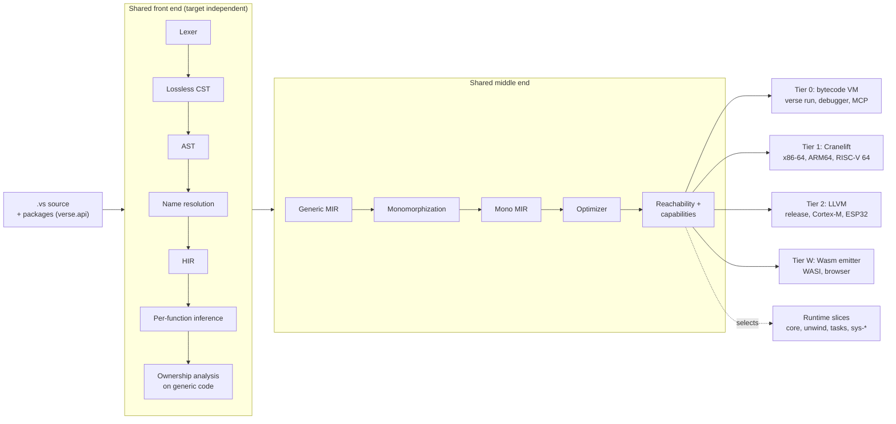

# 00. Overview

*Status: draft 1.*

This page explains, in plain language, how Verse will be built. The
specification ([../language/README.md](../language/README.md)) says what Verse programs
mean. The documents in this folder say how the toolchain turns those programs
into something that runs. **Nothing here is implemented yet.** Every number in
this folder is a *target*, not a measurement, and the labels *Decision*,
*Target*, *Assumption* and *Proposal* are used as defined in the
[README](README.md#conventions).

## What the implementation is

Verse ships as one command, `verse` (spec §16). Inside it there is one
compiler with one front end, one middle end and several interchangeable last
stages:

- The **front end** reads `.vs` files, checks names, infers types and checks
  ownership. It never knows which machine the program will run on.
- The **middle end** turns the checked program into MIR, a small explicit
  language in which every move, copy, drop and panic is written out. It then
  specializes generic code for the concrete types used (monomorphization),
  optimizes it, and works out exactly which functions, types and platform
  capabilities the program reaches.
- The **last stage** is chosen by the command: a bytecode virtual machine for
  `verse run` and debugging (tier 0), Cranelift for fast native builds
  (tier 1), LLVM for release and microcontroller builds (tier 2), or a
  WebAssembly emitter (tier W).
- The **runtime** is a Rust library split into *slices* (allocator, panics,
  tasks, file system, network, …). A program links only the slices its
  reachable code needs.

The full pipeline, with each stage's contract, is in
[02](compiler-architecture.md); the intermediate representations are in
[03](ir-and-passes.md).

## How each requirement is met

| Req. | Requirement (short) | How it is met | Read more |
|------|---------------------|---------------|-----------|
| R1 | Runs as a script and can be compiled | `verse run` and `verse build` share everything up to mono MIR; only the last stage differs, so a script and its compiled binary cannot mean different things. Differential tests compare them. | [04 §4.1](backends-and-targets.md#41-tiers), [10](testing-and-verification.md) |
| R2 | Easy to target Wasm, native, ARM, x86, IoT | Targets are data files plus a platform layer; the front and middle ends never see a target triple. | [04 §4.2–4.3](backends-and-targets.md#42-target-matrix), [05 §5.6](runtime.md#56-the-sys-capability-interface) |
| R3 | Extensible with native libraries | A plugin is a C-ABI library declared in `verse.toml` and called through `extern` blocks as plain calls. The VM loads it at start-up and the compiled tiers link it, with the same checks. Plugins never add syntax. Lints are built into the compiler, and generators are Verse packages run by `verse generate`. | [07](plugins.md), [ADR-0005](../decisions/0005-native-c-abi-plugins.md) |
| R4 | Really fast | Arena data structures, per-function parallel and incremental compilation, monomorphized code, explicit performance budgets in CI. | [02 §2.3, §2.7](compiler-architecture.md#23-data-structures), [09](performance.md) |
| R5 | Name the implementation language | **Rust** for compiler, runtime and tooling. | [ADR-0001](../decisions/0001-implementation-language.md) |
| R6 | Optional stdlib; only what is used is built in | Library tiers; `import` is the opt-in; whole-program reachability over mono MIR; capabilities select runtime slices; `verse build --size-report` explains every item. | [06](stdlib-and-shaking.md), [ADR-0004](../decisions/0004-whole-program-reachability.md) |
| — | Packages and tooling (supports R3, R6) | One `verse` tool; `verse.toml`, `verse.lock` and `verse.api`; minimal version selection; the first-party packages `finance`, `ml`, `web`, `gui`, `iot`. | [19](../reference/cli-and-manifest.md), [20](first-party-packages.md), [21](packages.md) |
| R7 | Debugging that is easy, especially for LLMs (MCP-like) | Diagnostics are structured data; a debugger and compiler exposed through an MCP server; record and replay on tier 0. | [08](debugging-and-mcp.md), [02 §2.8](compiler-architecture.md#28-diagnostics) |

## Guiding principles

1. **One meaning in both modes.** A program run with `verse run` and the same
   program built with `verse build` behave identically, including overflow
   checks, panics, `Cleanup` order and task outcomes. Every tier consumes the
   same mono MIR, and the semantics live in MIR, not in a backend.
2. **The specification wins.** When this folder and the specification
   disagree, the specification is right. Architecture documents may
   *propose* spec changes; they never assume them.
3. **Nothing is implemented yet, so numbers are targets.** No document in this
   folder reports a measurement. Sizes, times and speedups are budgets to be
   verified by the milestones in [11](../roadmap.md).
4. **Pay only for what you use.** A feature that a program does not reach
   costs it nothing: no code, no runtime slice, no start-up work.
5. **Explanations are part of the product.** Every error, every included item
   in a size report and every debugger answer can say *why*, as structured
   data that both people and LLMs can read.
6. **One obvious name per idea.** The library and the tools follow the
   specification's rule (spec §1.4): one module per idea, one way to opt in
   (an explicit `import`), no hidden configuration.

## Glossary

| Term | Meaning |
|------|---------|
| **CST** | Concrete syntax tree. A lossless tree of the source, including comments and whitespace, used by the formatter and the language server. Printing it gives back the file byte for byte. |
| **AST** | Abstract syntax tree. The structure of the program without trivia; every node has a stable id and a source span. |
| **HIR** | High-level IR. The AST with names resolved and convenience syntax (`otherwise`, `?`, `if … is`, interpolation, `with`, `for`, lifted chains) expanded into a small core. |
| **THIR** | Typed HIR: HIR with a type for every expression, still generic. |
| **MIR** | Mid-level IR: a control-flow graph of basic blocks in which moves, copies, drops, checked arithmetic and unwind edges are explicit. *Generic MIR* still has type parameters. |
| **Mono MIR** | MIR after monomorphization: every type is concrete and every call names a concrete function, an intrinsic or a trait-object slot. All backends consume it. |
| **Monomorphization** | Making a separate copy of a generic or unannotated function for each concrete set of types it is used with (spec §4.2). |
| **Tier** | One of the last stages: 0 bytecode VM, 1 Cranelift, 2 LLVM, W WebAssembly emitter. |
| **Target** | A machine and environment to build for, described by a target file (triple, pointer width, unwind and task strategy, available capabilities). |
| **Slice** | One separately linkable part of the runtime (`core`, `unwind`, `tasks`, `sys-fs`, `sys-net`, …), listed in [05 §5.1](runtime.md#51-feature-slices). |
| **Capability** | A named group of platform operations (`fs`, `net`, `clock`, `stdio`, `gpio`, …) that the standard library reaches through the `sys` interface. A target declares which ones it provides; a program's reachable code determines which ones it needs. |
| **Reachability** | The build-time analysis over optimized mono MIR that finds every function, type, vtable, constant and capability the program can use, starting from its roots. Everything else is left out. ([ADR-0004](../decisions/0004-whole-program-reachability.md)) |
| **Root** | A starting point for reachability: the entry file's top-level statements (Verse has no `fn main`, spec §12.5), test blocks in test builds, and exported items in library builds. |
| **Why chain** | The path of edges from a root to an included item, printed by `verse build --size-report` and returned by the MCP server. |
| **`verse.api`** | The committed file of a package's exported signatures (spec §16.4). Other modules are checked against it, never against source. |
| **Plugin** | A native library with a C interface, declared under `[plugins]` in `verse.toml` and called through an `extern` block. Verse cannot check the code inside it. ([07](plugins.md)) |
| **MCP** | Model Context Protocol: an open protocol through which an LLM-based tool calls structured tools on a server. `verse mcp` exposes the compiler and debugger this way. ([08](debugging-and-mcp.md)) |
| **ADR** | Architecture decision record: one file per major decision, with context, alternatives and consequences ([decisions/](../decisions/)). |
