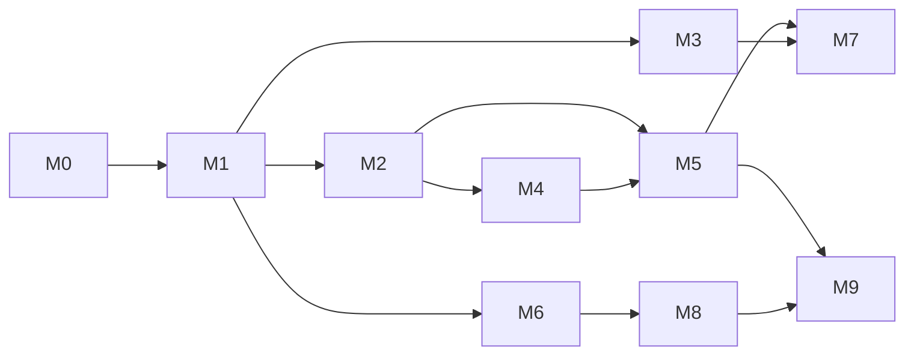

# 11. Roadmap

Milestones are vertical slices: each ends with something that runs, tests that
prove it, and a benchmark. Dependencies are explicit. Durations are
deliberately not given; estimating them before M0 gives us real velocity would
be invention.

| M | Name | Delivers | Exit criteria |
|---|------|----------|---------------|
| M0 | Foundations | repo layout, CI, lexer, CST, parser for the whole grammar, formatter (`verse fmt`) skeleton, diagnostics framework, benchmark and conformance harness | every spec example parses; `verse fmt` is idempotent on all of them; formatter property tests pass; harness runs |
| M1 | Script core | name resolution, HIR, type inference including implicit generics, ownership pass, generic MIR, mono, bytecode VM, minimal MCP server, minimal `core` runtime | the three spec §20 programs run in tier 0; ownership must-fail suite passes; hello world under 20 ms; `verse mcp` can launch, stop, inspect |
| M2 | Native | Cranelift backend for x86-64 and AArch64, linking, `core` runtime slice, reachability and `--size-report` | differential tests tier 0 vs native pass; hello world under 200 KB; compile speed target met |
| M3 | WebAssembly | Wasm emitter, `std-wasi` and `std-web` slices, state-machine task lowering prototype | differential tests include Wasm; hello world under 30 KB; runs in a browser and under a WASI runtime |
| M4 | Tasks | stackful scheduler, work stealing, channels, `Shared`, `Guarded`, cancellation, structured lifetimes (§11) | spec §11 conformance complete; spawn and channel benchmarks meet targets; ThreadSanitizer clean |
| M5 | Standard library core | `std.fs`, `std.net`, `std.text`, `std.time`, `std.json`, `std.task`, `std.math`, `std.num`, `std.random`, `std.process`, `std.env`, `std.cli`, `std.log` in Verse over `sys` capabilities; package manager, `verse.lock`, `verse.api`; Windows | all spec §15 examples run; `verse test` and doc tests work; shaking verified on each module |
| M6 | Tooling | language server with inline type hints, `verse doc`, `verse test --watch`, structured diagnostics JSON, record and replay | LSP passes a protocol test suite; replay reproduces a recorded task-heavy run exactly |
| M7 | Release and embedded | LLVM backend, release profile, Cortex-M and ESP32 targets, `--no-heap`, RISC-V | LLVM within target of Rust on benchmarks; blinky under 16 KB flash on a Cortex-M target |
| M8 | Plugins | plugin host, WIT interfaces, capability grants, first-party plugins (lint, bindgen) | a third-party lint plugin runs sandboxed and cannot read the file system; plugin API versioned |
| M9 | Domain libraries | first-party packages for finance, ML, web and GUI, IoT peripherals | each package imports only what it needs; each has a size report; example applications build for at least two targets |

## Principles for sequencing

1. **Front end before back ends.** M0 and M1 retire the highest-risk parts of
   the design (implicit generics, ownership on generic code) before any
   backend work starts.
2. **Interpreter first.** It is the reference for semantics, the debugger
   target, and the differential oracle. Native backends are checked against it.
3. **One backend per milestone.** Each new backend is measured against the
   previous one.
4. **Tasks after native.** The scheduler needs real stacks and real I/O.
5. **Plugins late.** The extension points are only stable after the compiler
   has real consumers; M8 stabilizes what M0 to M7 prove is needed. The
   debug protocol and diagnostics JSON, however, exist from M1.

## Risks and their milestones

| Risk | Why it matters | Retired by |
|------|----------------|------------|
| Implicit generics with structural constraints make inference or error messages bad | core promise of §4.2 | M1: inference on every spec example, plus 50 adversarial programs |
| Ownership error messages are hard to make good | §18.10 requires it | M1: golden diagnostics, review by language owners |
| Task lowering to state machines is hard and slow | Wasm and embedded depend on it | M3 prototype, M7 hardening |
| Cranelift lacks 32-bit ARM and RISC-V | embedded needs LLVM | verify in M2; LLVM arrives in M7 |
| Char-indexed `Text` is slow | P1 | M1 benchmark; ruled (Q3) |
| Domain libraries expand scope without end | M9 | each library is its own package with its own owner and release |
